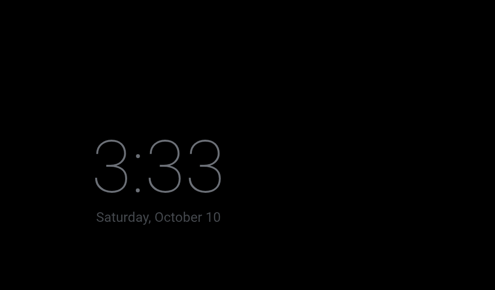

# Lenovo Smart Display 7 as a Home Assistant voice display

A Lenovo Smart Display 7 (CD-17302F, "Ivy", serial `HA0000XX`) unlocked from Google's
Android Things firmware and turned into a Home Assistant dashboard and voice satellite.
Built on 2026-10-09 from the XDA thread
<https://xdaforums.com/t/cd-17302f-lenovo-smart-display-7-ivy-avb-bootloader-unlock-firmware.4472041/>.

In Home Assistant the device is "Kitchen display" and sits in the Kitchen area. It was first
named "Den display", and the entity ids still say so (`sensor.den_display`,
`script.den_display_play_music`, `input_text.den_display_takeover_return`, the
`den_display_volume_*` webhooks): only the names were changed, so nothing that refers to an id broke.

**To repeat this build from scratch, follow [BUILD-GUIDE.md](BUILD-GUIDE.md).** It has every command in order, the problems hit, and the sources. This README is the short reference.

> **Identifiers in this repo are placeholders.** The display's serial (`HA0000XX`), MAC addresses,
> and some room names were replaced before publishing. IP addresses are private-range examples
> from the original network. Home Assistant ids (pipeline, config entries) are per-install; see
> Appendix A of the build guide for how to find yours. `ha/smart-display.yaml` is not included
> because it is generated; run `ha/build_smart_display.py` against your own Overview.

## What it does now

- Boots into **View Assist Companion App** (VACA 0.13.5) showing the `/smart-display` dashboard.
- **Voice**: wake word "Okay Nabu" (microWakeWord), Home Assistant Cloud speech-to-text and
  text-to-speech, local phrases first, Claude (Haiku 5.5 with web search) for everything else.
- **By voice**: timers and alarms, cameras by name, NFL scores (Seahawks by default),
  screen navigation, Spotify through Music Assistant.
- **Recipes and how-tos**: "how do I make peach cobbler" is web searched, answered from one
  named site with a one-line summary, and the page is sent to the owner's phone as a notification.
- **Cameras come to you**: a person or vehicle on a UniFi Protect camera, or a ring of the
  doorbell, puts that camera on the screen, live. It goes back to the tab it was on 30
  seconds after the camera is clear. Cameras do not take the screen from each other; only
  the doorbell does.
- **Camera views** are [Advanced Camera Card](https://card.camera): a grid of four
  refreshing snapshots, and one full-screen live view per camera (30 fps over HLS) opened
  by a tap, by voice or by a detection.
- **Physical volume rocker** sets one system-wide volume in ten 3 dB positions.
- **Burn-in protection**: after 5 minutes with nobody around (the display's own camera
  watches the room for motion), a full-screen slideshow of a shared Google Photos album with
  a clock over it. When the room is dark it shows a dim clock on black instead, which drifts
  around the screen. Only someone using it brings back the view it was on: a touch, the wake
  word, the volume rocker, or stepping up to within about two feet (the display's infrared
  proximity sensor). Movement across the room does not. The screen is never switched off.

## Screenshots

Captured from the display itself (1024x600) with `adb exec-out screencap -p`.


| Music, opened by a voice request | Sports |
|---|---|
|  |  |

| Outside lights and roof themes | Lights (some names blurred) |
|---|---|
|  |  |

| Cameras (pictures blurred for privacy) | Screen saver (placeholder photo) |
|---|---|
|  |  |

| Screen saver in a dark room | |
|---|---|
|  | |

## Layout of this folder

| Path | What it is |
|---|---|
| `flake.nix` | adb, fastboot, python with the libraries the scripts need. Use `nix develop --command …`. |
| `flash-debug-things.sh` | Shell port of the XDA firmware's `ToDebugThings.cmd`. Flashes both slots. |
| `wifi-connect.sh` | Joins Wi-Fi over adb (the firmware has no keyboard). Prompts for the password. |
| `fully-remote-admin.sh` | Turns on Fully Kiosk's remote admin. Only relevant if Fully is re-enabled. |
| `ha/ha_ws.py`, `ha/ha_rest.py` | Small Home Assistant WebSocket and REST helpers. Token from `~/.hass_token`. |
| `ha/ask.py` | Runs text through the voice pipeline as if spoken at the display. Best test tool here. |
| `ha/build_smart_display.py` | Generates the dashboard (`ha/smart-display.yaml`) from the main Overview. |
| `ha/themes/storm_at_sea.yaml`, `ha/install_theme.sh` | "Storm at Sea" dark theme (navy, slate, sea green, high-contrast text for the 7" screen) and the script that copies it to Home Assistant and makes it the default dark theme. |
| `ha/camera_voice.py`, `ha/nav_voice.py` | Voice automations for cameras and screen navigation. |
| `ha/camera_takeover.py` | The automation that shows a camera on a person or vehicle detection or a doorbell ring, then returns to the view the display was on. Only the doorbell takes the screen from another camera, and other cameras wait `COOLDOWN_SECONDS` (120) after a takeover starts. |
| `ha/tab_return.py` | The automation that puts the display back on its tab after a voice answer, timer or alarm view closes (View Assist would leave it on Home). |
| `ha/hls_only.py`, `ha/frontend/hls_only.js` | Makes live cameras on the display play over HLS instead of WebRTC, which freezes on this display's Wi-Fi. A display-only dashboard resource. |
| `ha/screen_saver.py`, `ha/frontend/kitchen_saver.js` | Burn-in protection: the activity, screen saver and light level automations, their helpers, and the saver card (slideshow with clock, or dark clock). Settings are constants at the top of the script. |
| `ha/photo_album.py`, `ha/album_sync.py` | The slideshow's photos: a helper holding one shared Google Photos album link, and the script Home Assistant runs every 6 hours to copy that album to `/config/www/kitchen_display/`. |
| `ha/volume_buttons.py` | The volume rocker automation (webhooks, 3 dB positions). |
| `ha/music_tool.py` | The "play music" script the AI calls (genres resolve to Spotify's own playlists), the shuffle automation, and the AI agent's whole prompt and settings. |
| `ha/phone_link_tool.py` | The "Send a link to the owner's phone" script the AI calls after a web search for a recipe or how-to. |
| `ha/blueprint_automations.py` | Record of the View Assist blueprint automations and the Seahawks default. |
| `device/lightsense.sh`, `device/lightsense.rc` | Reports the display's ambient light reading to Home Assistant, started at boot. |
| `device/proxsense.sh`, `device/proxsense.rc`, `device/src/proxsense.c` | Tells Home Assistant when someone is right at the display, from its proximity sensor. The C program reads the sensor over I2C (built with `zig cc`, command in the file); the script posts to a webhook; started at boot. |
| `device/volkeys.sh`, `device/volkeys.rc` | Volume button watcher installed on the display and its boot entry. |
| `downloads/` | Firmware zip, AVB unlock tool, APKs, and a backup of the stock WebView. Not in git. |
| `work/` | Scratch: screenshots, logs, probe scripts. Not in git. |

To change the dashboard, edit `ha/build_smart_display.py` and run:

```bash
nix develop --command sh -c '$AVB_PYTHON ha/build_smart_display.py work/ha/overview.json ha/smart-display.yaml && $AVB_PYTHON ha/ha_ws.py save-dashboard smart-display ha/smart-display.yaml'
```

`work/ha/overview.json` is a dump of the main Overview (`ha_ws.py call '{"type":"lovelace/config","url_path":null}'`);
refresh it if the Overview's quick actions or roof themes change.

## Reaching the display

- USB: `adb -s HA0000XX …`. Wireless: `adb connect 192.168.9.253:5555`.
- Wireless adb has **no authentication**. A UniFi rule allows only the Mac's Ethernet MAC to
  reach port 5555 from the internal networks; other IoT-VLAN devices are not filtered.
- `adb root` is needed after every reboot. `/system` is writable after `adb remount`.

## What was done to the display

1. Bootloader unlocked (`fastboot flashing unlock`), AVB unlocked with `at_auth_unlock.py`
   and the Ivy credentials from the XDA zip.
2. Flashed firmware 15.42.1 with `flash-debug-things.sh`: user image in slot A (active),
   debug image in slot B.
3. `adb disable-verity`, so `/system` can be modified.
4. Stock WebView 66 removed from `/system`; LineageOS WebView 138.0.7204.63 installed as an app.
5. Installed: VACA 0.13.5 (0.13.4 at first, updated in place with `adb install -r`), Simple Keyboard, Fully Kiosk 1.61.4 (now `pm disable`d).
6. Google packages disabled: `com.google.assistant.core`, `…things.internal.iotsetupwizard`,
   `…apps.quartz`, `…apps.mediashell`, `…things.checkin`, `…things.customcheckin`.
7. `persist.adb.tcp.port=5555`.
8. `/system/etc/hosts`: `10.0.1.174 homeassistant.local` (this Android cannot resolve `.local`).
9. Landscape: VACA's screen orientation setting is `landscape` (an earlier `settings put system user_rotation 1` is no longer what holds it).
10. `/system/bin/volkeys.sh` and `/system/etc/init/volkeys.rc` from `device/`.
11. Brightness: `settings put system screen_auto_brightness_adj 0.7` (brighter, flatter curve).
12. `appops set com.msp1974.vacompanion WRITE_SETTINGS allow`, so auto-brightness and VACA's
    brightness entities really move the backlight.
13. Camera reported as front-facing so VACA's motion detection can use it: one byte in
    `/vendor/lib/libcam.metadataprovider.so` (offset `0x4dc6`, `01` -> `00`) and the back-camera
    feature line removed from `/vendor/etc/permissions/android.hardware.camera.xml`.
    Originals are in `downloads/backup/`.
14. `/system/bin/proxsense`, `/system/bin/proxsense.sh` and `/system/etc/init/proxsense.rc`
    from `device/`: the proximity sensor (VCNL4200, I2C bus 2, address `0x51`) switched on
    and watched.

## What was done in Home Assistant

- **HACS**: View Assist, View Assist Companion App, TeamTracker (integration and card),
  button-card, layout-card, card-mod, Advanced Camera Card.
- **Add-on**: Music Assistant, with Spotify as a music source and the display added through
  the "Home Assistant MediaPlayers" player provider.
- **Integrations**: VACA device at `192.168.9.253:10800`; View Assist device "Kitchen display"
  (home `/smart-display/home`, music `/smart-display/music`, header and sidebar hidden);
  TeamTracker sensors `sensor.seahawks` and `sensor.team_tracker`; Anthropic ("Claude").
- **Voice pipeline** "Home Assistant Cloud": conversation agent Claude, prefer local intents on.
- **Exposed to voice** in addition to the defaults: the display's Music Assistant player,
  `script.den_display_play_music` and `script.send_link_to_phone`.
- **Dashboard** `smart-display` (generated), separate from the main Overview.
- **Automations**: three "View Assist - …" blueprint instances and eleven "Smart Display - …"
  ones (cameras by voice, camera on detection or doorbell, back to the tab after a voice
  answer, navigation, volume buttons,
  sports default team, shuffle local music requests, activity, screen saver, light level and
  refresh photo album; see `ha/`).
- **Helpers**: `input_text.den_display_takeover_return`, where the camera automation keeps
  the view to go back to; `input_button.kitchen_display_activity` (pressed on every sign of
  life at the display), `input_text.kitchen_display_saver_return`,
  `input_number.kitchen_display_lux`, `input_datetime.kitchen_display_lux_at`,
  `input_boolean.kitchen_display_dark`, and `input_text.kitchen_display_album_url` (the one
  setting for the slideshow's photos; the link is kept there and nowhere else).
- **Package** `/config/packages/kitchen_display.yaml`: the command-line sensor
  `sensor.kitchen_display_album` that syncs the album; the script it runs is
  `/config/kitchen_display/album_sync.py`.
- **Dashboard resources**: `ha/frontend/kitchen_saver.js` and `ha/frontend/hls_only.js`,
  registered as `data:` URLs (the second only acts on the display).
- **Camera entities**: the four "Medium resolution channel" UniFi Protect cameras enabled,
  because the display decodes at most 1920x1088 H.264.
- **VACA device settings**: wake engine microwakeword, wake word "Okay Nabu", threshold 6
  (5 woke on random speech about five times a day), mic gain 5, wake sound "Home Assistant", assistant "Home Assistant Cloud", landscape,
  motion detection "motion" at sensitivity 20.

## What was done on the network (UniFi)

- DHCP reservation: `aa:bb:cc:dd:ee:01` -> `192.168.9.253`.
- Two Internal->IOT policies for adb port 5555 (allow the Mac, reject the rest).
- "Allow IOT to Home Assistant" ports extended from `1883,8123` to `1883,8123,8097`
  (8097 is Music Assistant's stream server; without it music is silent).
- Rollback notes are in `~/.local/state/unifi-mcp/skills/firewall-snapshots/`.

## Things learned the hard way

- **Use microWakeWord.** openWakeWord pegged the CPU at 262%, which starved Wi-Fi and showed
  up as "unable to connect to Home Assistant".
- **Wait about 15 seconds after `pm disable` before rebooting**, or the change is lost.
- **Don't change VACA's mic gain while it is running.** The audio stream went malformed
  (cloud STT answered "400 Invalid HTTP request") until the app was restarted.
- **Force-stopping VACA drops Wi-Fi for about 15 seconds.**
- **Init services can't use the `su` SELinux domain directly** on this build. Go
  init -> shell -> `/system/xbin/su`, as `device/volkeys.rc` does.
- **The volume buttons are GPIO lines 429 (up) and 576 (down)**, not Android keys.
- **Three volume layers**: Android media stream (`number.…_music_volume`), the Music Assistant
  player's gain (pinned at 100%), and separate voice and alarm levels.
- **The Android volume curve is steep at the bottom**: index 50 is -21 dB. Hence the table
  in `ha/volume_buttons.py`.
- **Pace fastboot commands about a second apart**; this bootloader garbles replies otherwise.
- **`media volume` and `input keyevent` take over a second each** on this hardware, which is
  why the rocker goes through Home Assistant.
- **View Assist goes to its home screen whenever the mode changes.** To return to another
  view after changing it, restore the mode first, wait a second, then navigate. The camera
  takeover avoids the mode altogether now.
- **View Assist's `current_path` only follows `view_assist.navigate`.** A tab opened by touch
  never shows up there, so anything that has to return "where the display was" reads
  `sensor.vaca_…_current_path` (the companion app's own report) instead. And any
  `view_assist.navigate` to a view other than home needs `revert_timeout: 0`, or View Assist
  sends the display home after its 20 second view timeout.
- **WebRTC video freezes on this display; HLS does not.** About 1 UDP packet in 5 is lost
  on its Wi-Fi link and nothing resends them, so a WebRTC camera ran for 20-30 seconds and
  then showed a frame every few seconds. `ha/frontend/hls_only.js` makes the display ask
  for HLS: 30 fps with no dropped frames, about 4 seconds behind, 5-10 seconds to start.
- **Smooth video costs about one core more than frozen video** (2.8 of 4 cores busy with a
  camera full screen, against 1.7). The wake word and voice still worked with it up. Four
  live cameras at once used all four cores and dropped half the frames, so the grid stays
  on snapshots.
- **Advanced Camera Card's snapshot provider fetches full-size frames** unless
  `image.entity_parameters` asks for a size; four 1.3 MB pictures every 10 seconds cost
  half a core on the grid.
- **Skip Home Assistant 2026.10.0 with UniFi Protect.** FFmpeg 9 in that release rejects
  Protect's self-signed RTSPS certificate ([core issue 184775](https://github.com/home-assistant/core/issues/184775)):
  cameras went `unavailable` after any live view, and each live view left two HLS requests
  hanging in the display's browser until its six connections were used up and the camera
  snapshots went blank. Fixed in 2026.10.1. The two workarounds this build carried (an
  automation reloading Protect, and a dashboard script refusing HLS on the display) were
  tested off and removed on 2026-10-11; BUILD-GUIDE step 11 has the story and the test.
- **The WebView's remote debugger finds display-side problems**
  (`adb forward tcp:9333 localabstract:webview_devtools_remote_<pid>`, then the DevTools
  protocol). It is how the hanging requests were found.
- **VACA's camera motion detection needs a front camera, and this HAL says "back".** The
  facing is one byte of static metadata in `libcam.metadataprovider.so` (BUILD-GUIDE step
  17a.1). Detection then costs about half of one core once boot has settled (0.9 at first).
- **VACA's brightness entities do nothing until the app may write system settings**
  (`appops set … WRITE_SETTINGS allow`). After that, brightness 0 is backlight off.
- **VACA's "Screen" switch only draws a black overlay** on this device, and a tap does not
  clear it. Its "Screen saver" switch is a black overlay a tap does clear.
- **A `pattern` on an `input_text` helper left it `unavailable` after a restart.**
- **`view_assist.navigate` with `revert_timeout: 0` holds a view** without changing the mode.
- A fixed phrase answered by an automation appears to the AI as a reply with no tool call.
  Its prompt has to say those are real, or it "corrects" them.

## Going back

- Fully Kiosk as the main screen: `pm enable de.ozerov.fully`, then force-stop VACA.
- Stock Google firmware: flash the user image from the XDA zip and relock AVB
  (`fastboot oem at-lock-vboot`). Google's OTA servers are gone, so setup may not complete.

## Not verified

- The camera automation with a real doorbell press. It was tested with simulated ring and
  detection states and has been left to run on real detections.
- That the brightness setting survives a reboot.
- NFL teams other than the Seahawks, 49ers and Cowboys by voice.
- `ha/blueprint_automations.py` as a script (the automations it describes exist and work).
- The light sensor through a real nightfall. The reporter runs and its readings arrive, but
  the dark and bright thresholds have only been tested by posting readings by hand.
- The dark clock in a really dark room (it was forced on in daylight), and whether the
  camera stays quiet enough at night for the bright-room case.
- A person walking up to the saver after the proximity reporter was installed. The sensor
  was measured with a person at set distances, and a posted reading wakes the saver, but
  nobody has yet walked up to a showing saver with the whole chain running.
- Waking the saver with the spoken wake word. VACA's "Wake" button (the same satellite
  path), a spoken announcement, a touch, the volume webhook and a camera takeover all woke
  it; the wake word itself was not spoken at it.
- That real movement across the room leaves the saver alone. The camera's motion state was
  set by hand for the test, and the saver stayed.
- "face" detection mode, and a real doorbell press while the saver is up.
- A whole evening of the HLS live views. They were watched for a few minutes at a time,
  and through two real detections during testing, not for the full 5 minutes a takeover
  can last, and not at night (infrared picture, different bitrate).
- The spoken wake word with a camera on screen was played through the display's own
  speaker, not spoken by a person across the room.
