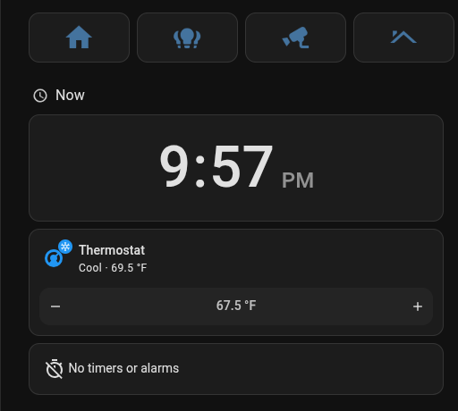
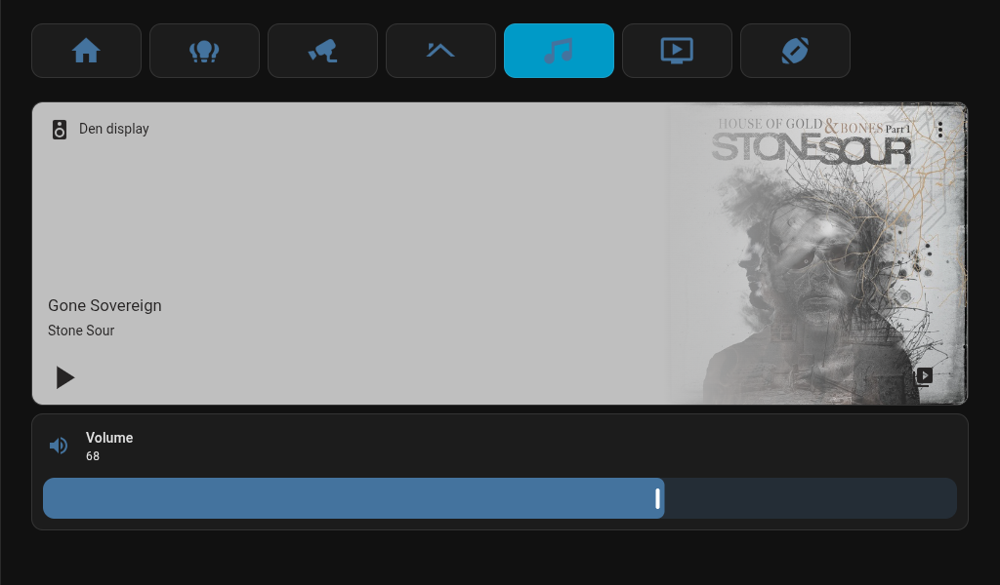
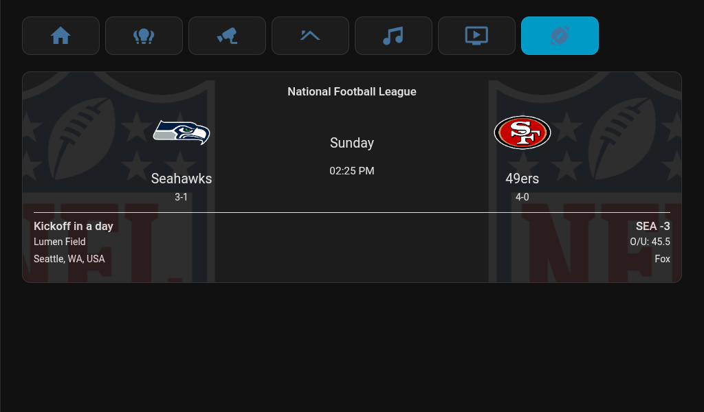
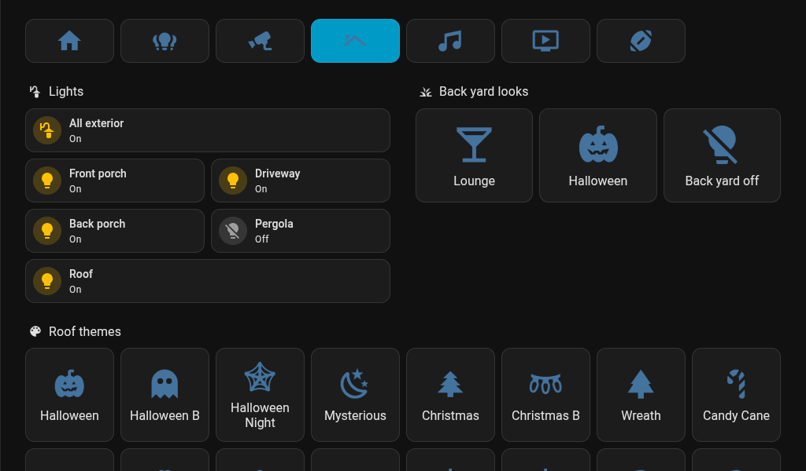
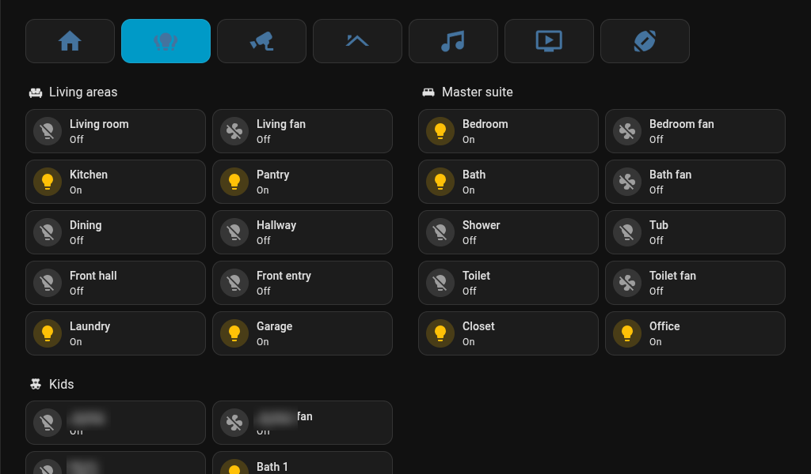
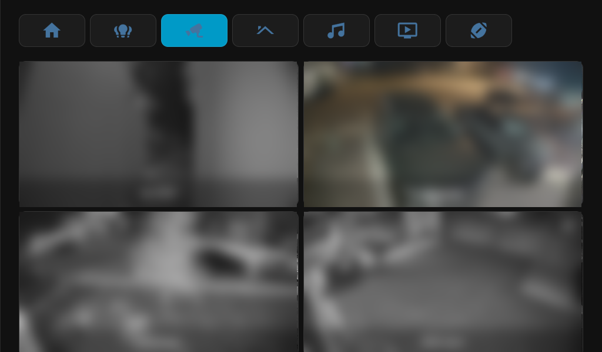

# Lenovo Smart Display 7 as a Home Assistant voice display

A Lenovo Smart Display 7 (CD-17302F, "Ivy", serial `HA0000XX`) unlocked from Google's
Android Things firmware and turned into a Home Assistant dashboard and voice satellite.
Built on 2026-10-09 from the XDA thread
<https://xdaforums.com/t/cd-17302f-lenovo-smart-display-7-ivy-avb-bootloader-unlock-firmware.4472041/>.

In Home Assistant the device is "Kitchen display" and sits in the Kitchen area. It was first
named "Den display", and the entity ids still say so (`sensor.den_display`,
`script.den_display_play_music`, `input_text.den_display_takeover_return`, the
`den_display_volume_*` webhooks): only the names were changed, so nothing that refers to an id broke.

**To repeat this build from scratch, follow [BUILD-GUIDE.md](BUILD-GUIDE.md).** It has every command in order, the problems hit, and the sources. This README is the short reference.

> **Identifiers in this repo are placeholders.** The display's serial (`HA0000XX`), MAC addresses,
> and some room names were replaced before publishing. IP addresses are private-range examples
> from the original network. Home Assistant ids (pipeline, config entries) are per-install; see
> Appendix A of the build guide for how to find yours. `ha/smart-display.yaml` is not included
> because it is generated; run `ha/build_smart_display.py` against your own Overview.

## What it does now

- Boots into **View Assist Companion App** (VACA 0.13.4) showing the `/smart-display` dashboard.
- **Voice**: wake word "Okay Nabu" (microWakeWord), Home Assistant Cloud speech-to-text and
  text-to-speech, local phrases first, Claude (Haiku 5.5 with web search) for everything else.
- **By voice**: timers and alarms, cameras by name, NFL scores (Seahawks by default),
  screen navigation, Spotify through Music Assistant.
- **Recipes and how-tos**: "how do I make peach cobbler" is web searched, answered from one
  named site with a one-line summary, and the page is sent to the owner's phone as a notification.
- **Cameras come to you**: a person or vehicle on a UniFi Protect camera, or a ring of the
  doorbell, puts that camera on the screen. It goes back to what it was showing 30 seconds
  after the camera is clear.
- **Physical volume rocker** sets one system-wide volume in ten 3 dB positions.

## Screenshots

Captured from the display itself (1024x600) with `adb exec-out screencap -p`.



| Music, opened by a voice request | Sports |
|---|---|
|  |  |

| Outside lights and roof themes | Lights (some names blurred) |
|---|---|
|  |  |

| Cameras (pictures blurred for privacy) | |
|---|---|
|  | |

## Layout of this folder

| Path | What it is |
|---|---|
| `flake.nix` | adb, fastboot, python with the libraries the scripts need. Use `nix develop --command …`. |
| `flash-debug-things.sh` | Shell port of the XDA firmware's `ToDebugThings.cmd`. Flashes both slots. |
| `wifi-connect.sh` | Joins Wi-Fi over adb (the firmware has no keyboard). Prompts for the password. |
| `fully-remote-admin.sh` | Turns on Fully Kiosk's remote admin. Only relevant if Fully is re-enabled. |
| `ha/ha_ws.py`, `ha/ha_rest.py` | Small Home Assistant WebSocket and REST helpers. Token from `~/.hass_token`. |
| `ha/ask.py` | Runs text through the voice pipeline as if spoken at the display. Best test tool here. |
| `ha/build_smart_display.py` | Generates the dashboard (`ha/smart-display.yaml`) from the main Overview. |
| `ha/camera_voice.py`, `ha/nav_voice.py` | Voice automations for cameras and screen navigation. |
| `ha/camera_takeover.py` | The automation that shows a camera on a person or vehicle detection or a doorbell ring, then returns to the previous view. |
| `ha/protect_stream_workaround.py` | Temporary: reloads UniFi Protect when a camera drops on Home Assistant 2026.10.0. Not needed from 2026.10.1. |
| `ha/hls_guard.py`, `ha/frontend/hls_guard.js` | Temporary: stops live camera views from exhausting the display browser's connections on Home Assistant 2026.10.0. |
| `ha/volume_buttons.py` | The volume rocker automation (webhooks, 3 dB positions). |
| `ha/music_tool.py` | The "play music" script the AI calls (genres resolve to Spotify's own playlists), the shuffle automation, and the AI agent's whole prompt and settings. |
| `ha/phone_link_tool.py` | The "Send a link to the owner's phone" script the AI calls after a web search for a recipe or how-to. |
| `ha/blueprint_automations.py` | Record of the View Assist blueprint automations and the Seahawks default. |
| `device/volkeys.sh`, `device/volkeys.rc` | Volume button watcher installed on the display and its boot entry. |
| `downloads/` | Firmware zip, AVB unlock tool, APKs, and a backup of the stock WebView. Not in git. |
| `work/` | Scratch: screenshots, logs, probe scripts. Not in git. |

To change the dashboard, edit `ha/build_smart_display.py` and run:

```bash
nix develop --command sh -c '$AVB_PYTHON ha/build_smart_display.py work/ha/overview.json ha/smart-display.yaml && $AVB_PYTHON ha/ha_ws.py save-dashboard smart-display ha/smart-display.yaml'
```

`work/ha/overview.json` is a dump of the main Overview (`ha_ws.py call '{"type":"lovelace/config","url_path":null}'`);
refresh it if the Overview's quick actions or roof themes change.

## Reaching the display

- USB: `adb -s HA0000XX …`. Wireless: `adb connect 192.168.9.253:5555`.
- Wireless adb has **no authentication**. A UniFi rule allows only the Mac's Ethernet MAC to
  reach port 5555 from the internal networks; other IoT-VLAN devices are not filtered.
- `adb root` is needed after every reboot. `/system` is writable after `adb remount`.

## What was done to the display

1. Bootloader unlocked (`fastboot flashing unlock`), AVB unlocked with `at_auth_unlock.py`
   and the Ivy credentials from the XDA zip.
2. Flashed firmware 15.42.1 with `flash-debug-things.sh`: user image in slot A (active),
   debug image in slot B.
3. `adb disable-verity`, so `/system` can be modified.
4. Stock WebView 66 removed from `/system`; LineageOS WebView 138.0.7204.63 installed as an app.
5. Installed: VACA 0.13.4, Simple Keyboard, Fully Kiosk 1.61.4 (now `pm disable`d).
6. Google packages disabled: `com.google.assistant.core`, `…things.internal.iotsetupwizard`,
   `…apps.quartz`, `…apps.mediashell`, `…things.checkin`, `…things.customcheckin`.
7. `persist.adb.tcp.port=5555`.
8. `/system/etc/hosts`: `10.0.1.174 homeassistant.local` (this Android cannot resolve `.local`).
9. Landscape: VACA's screen orientation setting is `landscape` (an earlier `settings put system user_rotation 1` is no longer what holds it).
10. `/system/bin/volkeys.sh` and `/system/etc/init/volkeys.rc` from `device/`.
11. Brightness: `settings put system screen_auto_brightness_adj 0.7` (brighter, flatter curve).

## What was done in Home Assistant

- **HACS**: View Assist, View Assist Companion App, TeamTracker (integration and card),
  button-card, layout-card, card-mod.
- **Add-on**: Music Assistant, with Spotify as a music source and the display added through
  the "Home Assistant MediaPlayers" player provider.
- **Integrations**: VACA device at `192.168.9.253:10800`; View Assist device "Kitchen display"
  (home `/smart-display/home`, music `/smart-display/music`, header and sidebar hidden);
  TeamTracker sensors `sensor.seahawks` and `sensor.team_tracker`; Anthropic ("Claude").
- **Voice pipeline** "Home Assistant Cloud": conversation agent Claude, prefer local intents on.
- **Exposed to voice** in addition to the defaults: the display's Music Assistant player,
  `script.den_display_play_music` and `script.send_link_to_phone`.
- **Dashboard** `smart-display` (generated), separate from the main Overview.
- **Automations**: three "View Assist - …" blueprint instances and six "Smart Display - …"
  ones (cameras by voice, camera on detection or doorbell, navigation, volume buttons,
  sports default team, and a temporary one that reloads UniFi Protect when a camera drops;
  see `ha/`).
- **Helper**: `input_text.den_display_takeover_return`, where the camera automation keeps
  the view to go back to.
- **Camera entities**: the four "Medium resolution channel" UniFi Protect cameras enabled,
  because the display decodes at most 1920x1088 H.264.
- **VACA device settings**: wake engine microwakeword, wake word "Okay Nabu", threshold 5,
  mic gain 5, wake sound "Home Assistant", assistant "Home Assistant Cloud", landscape.

## What was done on the network (UniFi)

- DHCP reservation: `aa:bb:cc:dd:ee:01` -> `192.168.9.253`.
- Two Internal->IOT policies for adb port 5555 (allow the Mac, reject the rest).
- "Allow IOT to Home Assistant" ports extended from `1883,8123` to `1883,8123,8097`
  (8097 is Music Assistant's stream server; without it music is silent).
- Rollback notes are in `~/.local/state/unifi-mcp/skills/firewall-snapshots/`.

## Things learned the hard way

- **Use microWakeWord.** openWakeWord pegged the CPU at 262%, which starved Wi-Fi and showed
  up as "unable to connect to Home Assistant".
- **Wait about 15 seconds after `pm disable` before rebooting**, or the change is lost.
- **Don't change VACA's mic gain while it is running.** The audio stream went malformed
  (cloud STT answered "400 Invalid HTTP request") until the app was restarted.
- **Force-stopping VACA drops Wi-Fi for about 15 seconds.**
- **Init services can't use the `su` SELinux domain directly** on this build. Go
  init -> shell -> `/system/xbin/su`, as `device/volkeys.rc` does.
- **The volume buttons are GPIO lines 429 (up) and 576 (down)**, not Android keys.
- **Three volume layers**: Android media stream (`number.…_music_volume`), the Music Assistant
  player's gain (pinned at 100%), and separate voice and alarm levels.
- **The Android volume curve is steep at the bottom**: index 50 is -21 dB. Hence the table
  in `ha/volume_buttons.py`.
- **Pace fastboot commands about a second apart**; this bootloader garbles replies otherwise.
- **`media volume` and `input keyevent` take over a second each** on this hardware, which is
  why the rocker goes through Home Assistant.
- **View Assist goes to its home screen whenever the mode changes.** To return to another
  view after a camera, restore the mode first, wait a second, then navigate.
- **Home Assistant 2026.10.0 marks UniFi Protect cameras `unavailable` after any live view**
  while the picture on the display is fine. FFmpeg 9 in that release rejects Protect's
  self-signed RTSPS certificate ([core issue 184775](https://github.com/home-assistant/core/issues/184775)).
  Fixed in 2026.10.1; until then `ha/protect_stream_workaround.py` reloads the integration
  after each drop. Delete that automation after updating.
- **The same bug blanks the camera snapshots on the display.** The frontend starts HLS next
  to WebRTC for every live view, the HLS playlist request never answers on 2026.10.0, and it
  is not cancelled when the view closes. Each live view leaves two requests hanging; a
  browser allows six connections per server, so after three live views nothing else loads.
  `ha/hls_guard.py install` registers a small script (`ha/frontend/hls_guard.js`) that
  refuses HLS on the display only, so live views use WebRTC alone. Run
  `ha/hls_guard.py remove` after updating. Found with the WebView's remote debugger
  (`adb forward tcp:9333 localabstract:webview_devtools_remote_<pid>`).
- A fixed phrase answered by an automation appears to the AI as a reply with no tool call.
  Its prompt has to say those are real, or it "corrects" them.

## Going back

- Fully Kiosk as the main screen: `pm enable de.ozerov.fully`, then force-stop VACA.
- Stock Google firmware: flash the user image from the XDA zip and relock AVB
  (`fastboot oem at-lock-vboot`). Google's OTA servers are gone, so setup may not complete.

## Not verified

- The camera automation with a real doorbell press. It was tested with simulated ring and
  detection states and has been left to run on real detections.
- That the brightness setting survives a reboot.
- NFL teams other than the Seahawks, 49ers and Cowboys by voice.
- `ha/blueprint_automations.py` as a script (the automations it describes exist and work).
